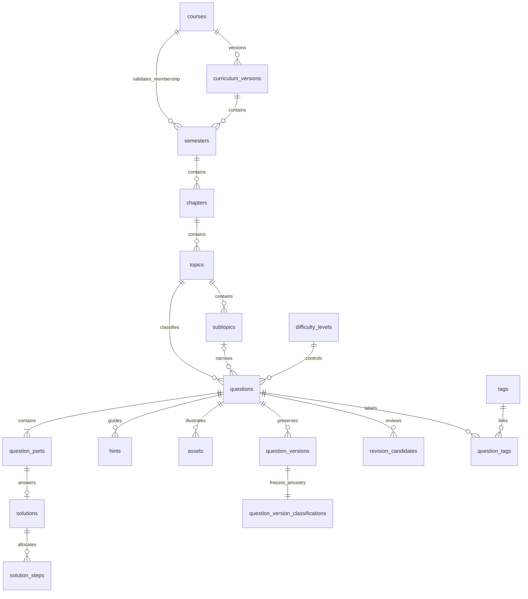

# Database and revision architecture

## Canonical content

See [editable curriculum](curriculum.md) for version lifecycle, guarded edits/imports and frozen classification. Course ancestry now includes the semester's curriculum version; the original parent keys remain compatible.

The active question has normalized metadata, parts, solutions, solution steps, hints, assets and tag links. Each atomic save writes those records and a complete versioned JSON snapshot in one transaction. Detail and historical views read those structured snapshots; browse/search reads the normalized active records. The two representations are synchronized only by the transaction service.

A question stores `topic_id` and optional `subtopic_id`; it does not duplicate course, semester or chapter foreign keys. The full ancestry is joined through topic → chapter → semester → course. A composite foreign key ensures an assigned subtopic belongs to the same topic. Nested part references include the question ID, so parts cannot reference another question's parts. Solutions, hints and assets have corresponding relational constraints. Cycle and structural validation precede writes.

Difficulty is an extensible lookup table. Status and question type use database CHECK constraints and versioned schema enums. The seed contains only the actual requested course/semesters/difficulties. TEST ONLY taxonomy and questions exist exclusively in test fixtures.

## Revisions and approval

- Draft/reviewing/retired changes create a version at an explicit save event. No keystroke persistence exists.
- Editing an approved question, requesting approved status on an existing record, or ingesting any PDF candidate creates a pending revision. The active content and search index remain unchanged.
- Candidates preserve their source (`manual`, `json`, `pdf`), base version, snapshot, revision note, author, dates, and reviewing teacher/decision. Future PDF candidates additionally retain their source PDF URL.
- Approval requires an explicit decision and a reviewing teacher's name. Promotion uses a transaction and checks the base version against the current version to prevent stale replacements.
- Rejection records the decision and leaves active content unchanged. A stale candidate can be rejected; to approve a stale revision, recompare and submit against the current version.
- Version rows have immutable-update/delete triggers. Original snapshots and their asset URLs remain available through historical preview.
- Initial creation with Approved status requires explicit human confirmation and a solution for each leaf part. Marks mismatches remain warnings, preserving all authored marks.

## Search and scale

FTS5 indexes active question code, title, scenario, part prompts, course/semester/chapter/topic/subtopic names and tags. Search terms are tokenized and quoted before FTS MATCH to avoid treating user input as an FTS expression. Search does not include answers or teacher notes.

Server queries combine filters with AND; multiple selected topics use OR within the topic filter. Comma-separated tags require all supplied tags. Pagination returns at most 100 metadata cards per request (20 by default). No endpoint downloads all questions for client-side filtering. Counts use aggregate queries rather than example numbers.

Indexes cover taxonomy joins, topic/difficulty/status/marks, status/difficulty/marks, subtopic, total marks, tags, revisions and the unique question code. Parent-scoped unique slugs and normalized-name checks prevent duplicate taxonomy from spacing/capitalization variants.

## Import and uploads

Shared strict Zod validation checks the document version, metadata, controlled difficulty, status, parts, nested hierarchy, references, solutions, equation syntax and assets before writes. Imports either use foreign-key IDs or resolve a full contextual classification path. No taxonomy is silently created. A duplicate question code is an error when creating a new record; updating requires the explicit existing-question revision action and a base version.

Uploads support SVG, PNG, JPEG, WebP and PDF up to 20 MB, using signature checks and unique filenames. SVG active/external content is rejected; file responses also carry a sandbox CSP and `nosniff`. Local asset links must resolve to uploaded files with matching MIME extensions. HTTPS asset URLs are supported without fetching them on the server; their availability is the author's responsibility.

## Future PDF adapter

`PdfRevisionImportService` accepts an injected extractor interface. Extraction produces a candidate JSON document, which goes through the same classification resolution, validation, comparison and pending-review service. No extractor is shipped. The API returns 501 with a clear explanation until an adapter is configured. The service never directly promotes a PDF candidate, including for drafts.

## Scope and deployment

This phase targets a single trusted teacher on a loopback server. Preview mode separates visible student and teacher content but is not authentication. Multi-user access, authenticated authorization, hosted file storage, PDF extraction and exam generation are future work. Uploaded archives and structured content remain independent of any parser or examination numbering.
